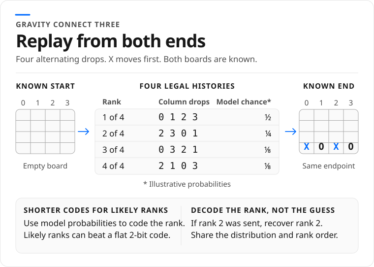

# Replay From Both Ends

How much of a game replay can you discard if you already know what the board looks like at both ends?



In four-ply, 4x4 gravity Connect Three, the endpoint limits which columns each player used. The codec enumerates legal histories and sends the rank of the one that happened. A unique history needs no additional payload. When several histories fit, an exact interval code can spend fewer bits on likely ones. A wrong top guess costs bits; it does not discard the true history.

## Results

All methods reconstructed every tested move exactly. Of 1,000 simulated test segments, 720 had multiple legal histories and 280 had only one.

| Method, same 1,000 segments | Move payload | Complete stream |
| --- | ---: | ---: |
| Forward legal moves, uniform | 6,758 bits | 8,853 B |
| Endpoint histories, uniform | 1,055 bits | 8,140 B |
| Endpoint histories, fitted transitions | **411 bits** | **8,060 B** |

The endpoint alone saved **713 B (8.1%)** of complete stream size. Both codecs include the same 8,008 B of snapshots and framing.

| Method, same 128 ambiguous segments | Move payload | Complete stream |
| --- | ---: | ---: |
| Endpoint histories, uniform | 191 bits | 1,056 B |
| Endpoint histories, fitted transitions | **84 bits** | **1,043 B** |
| Frozen Gemma 3 | 257 bits | 1,065 B |
| LoRA-tuned Gemma 3 | 198 bits | 1,057 B |

Fine-tuning saved **8 B versus frozen Gemma** but was **1 B worse than uniform** and **14 B worse than fitted transitions**. The local run used 484 ambiguous training examples, 95 validation examples, and 160 optimizer updates. The transition baseline used all 640 training segments, including singletons. The adapter weighs 1,693,431 B; the base weight file weighs 871,767,174 B. See the [measured results](RESULTS.json) for timings, seeds and exact sizes. These are single-run measurements, not estimates of cross-hardware performance.

## Reproduce

Python 3.11 or newer is sufficient for the codec and simulated benchmark. The training comparison uses MLX-LM 0.32.2 on Apple Silicon, with the BF16 [Gemma 3 270M instruct conversion](https://huggingface.co/mlx-community/gemma-3-270m-it-bf16/tree/c806ef3a4ed971bd75aaee3346e0fef808512f03) available locally.

```sh
python -m unittest -v
python experiment.py
python experiment.py --prepare run/data
mlx_lm.lora --model "$MODEL_DIR" --train --data run/data \
  --iters 160 --batch-size 4 --num-layers 4 --max-seq-length 256 \
  --mask-prompt --learning-rate 0.0001 --val-batches 4 \
  --steps-per-report 20 --steps-per-eval 80 --save-every 160 \
  --seed 19 --adapter-path run/adapter
python experiment.py --model "$MODEL_DIR" --adapter run/adapter
```

## Scope

- All streams include the same start and end snapshots. This measures compression **with snapshots**, not against plain game logs that never store them.
- Simulated play has an explicit transition bias. A first-order model fitted on training moves is therefore a serious baseline; Gemma is not assumed to beat it.
- Both model encoders and decoders must agree on the exact quantized probabilities and canonical path order. The benchmark caches those probabilities, does not include their delivery cost in stream bytes, and reports checkpoint sizes separately.
- This is a local experiment, not a HALO submission or a claim of novelty. The original [ASC Chess](https://github.com/Anemosalo/ASC-Chess-Implementation) motivated the search for a small, testable coding trick; this implementation uses endpoint constraints rather than stashed aliases.
